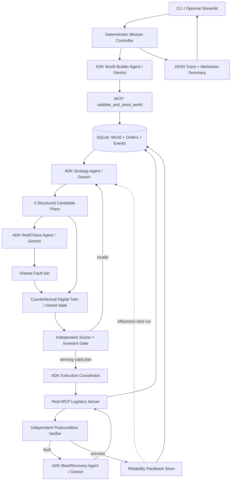

# PARADOX — Build & Verification Contract for Claude Code

**Status:** Implementation handoff | **Target:** Google Developer Community Agentic Wars | **Timebox:** 60 minutes for first runnable MVP | **Primary audience:** Autonomous AI reviewer running a public GitHub repository

> **Claude Code instruction:** Treat this entire document as the implementation contract. Deliver runnable code, real ADK agent/model invocations, genuine MCP tool calls, reproducible evidence, and honest test results. Do not spend the timebox on a proposal, slides, or a cosmetic mockup. Work autonomously through build → run → debug → test → document → commit. Never claim a verification you did not perform.

## 1. Winning thesis

**PARADOX: Predictive Autonomous Recovery & Digital Operations eXchange**

**Tagline:** *Don't just recover from failure. Prevent the future that causes it.*

Conventional multi-agent logistics applications dispatch a chain of procurement → inventory → warehouse → courier agents and react to faults. PARADOX **runs a counterfactual tournament**: an ADK Strategy Agent proposes alternative fulfillment plans; an ADK Red/Chaos Agent generates targeted failures; a deterministic digital twin stress-tests all plans against the **same** faults without modifying the real execution state; a policy gate chooses a feasible plan based on observed scores; an ADK Blue/Recovery Agent reacts to any real simulated execution failures via MCP tools; independent state assertions prove whether recovery worked. An operational feedback store changes future plan ranking.

**Crucial integrity statement:** This is a simulated logistics system; "real" means actual working agent → MCP → persistent simulation transitions, **not** a real supplier purchase or courier dispatch. It must never claim actual delivery, predictive certainty, or proven superiority unless run evidence supports it.

### AI judge should discover within 2 minutes

1. `README.md` says **what is novel**, **how to run**, **how to verify**.
2. `python -m paradox demo --scenario driver_failure --json-output artifacts/demo.json` (or documented equivalent) executes a full order, visibly exercising ADK and MCP when credentials are available.
3. `python -m paradox benchmark --runs 5 --json-output artifacts/benchmark.json` measures cheapest-first baseline vs PARADOX on the exact same synthetic worlds/fault suites.
4. `pytest -q` checks state invariants and reliability without needing LLM credentials.
5. `artifacts/*.json` is machine-readable, generated at runtime, and accompanied by descriptive Markdown (do not commit fake passing reports).
6. An optional Streamlit dashboard renders these same underlying events, not a disconnected staged sequence.

## 2. Non-negotiable submission constraints

- Use **Google ADK Python** with multiple actually-invoked Gemini-backed agents, not plain Python functions named "agents".
- Use an **actual MCP server** (`mcp` / FastMCP) and ADK `McpToolset` with local stdio; prove tools are exposed and invoked over the protocol. No fake direct-function bypass for the claimed MCP path.
- Synthetic/mock business data must **originate from the World Builder ADK agent**, including simulation parameters, inventory, suppliers, warehouses, drivers, routes, and event probabilities. The MCP persistence layer validates and saves agent output; it must not independently invent a world. Fixed IDs, domain enums, schemas, validation bounds, **test fixtures**, and scenario constraints are allowed. Label deterministic fixtures as `test_fixture` and never pass them off as generated data.
- The **entire physical workflow is simulated** using agent-issued tool calls: create order, stock check, procure, reserve, pack, assign/dispatch, deliver, verify.
- Provide **at least one working self-healing fault** with evidence of the original failure, recovery action, and independent postcondition verification. Supplier and driver faults preferred.
- Real fault injection must target the simulated **execution** state, not only produce a narrative. Counterfactual injection must never touch execution state.
- Explainability is a summary of evidence, alternatives and actions, **not** private chain of thought.
- GitHub-ready: `.gitignore`, no secrets, no committed DB, no fake logs, clear dependency/install commands, MIT license if desired.
- No paid third-party logistics APIs or browser accounts required. Only Gemini key is needed for LLM-backed end-to-end operation.
- **No model key:** deterministic unit tests run; the live agent demo must explicitly fail with a friendly missing-key error, not silently impersonate model calls.

## 3. Architecture: why each actor exists



**Do not use an LLM as the database, deterministic simulator, scoring oracle, security gate, or assertion engine.** These must be code-backed. Use LLMs for world synthesis, alternative strategy generation, adversarial fault selection, and recovery choice. If needed, execution may be a thin ADK agent driving MCP operations; otherwise the Mission Controller must route execution tool calls through a genuine ADK Execution Agent.

### Minimal agent set (P0)

| Actor | Must be LLM-backed? | Input | Output | Evidence |
|---|---|---|---|---|
| World Builder | Yes, ADK | Scenario constraints, domain schema | Validated world JSON | model invocation and seed MCP call |
| Strategy | Yes, ADK | Order, world snapshot, reliability | 3 distinct candidate plan JSONs | differences in supplier/warehouse/driver/backups |
| Red/Chaos | Yes, ADK | Plans, capacities, fault catalog | 2–3 plausible targeted fault cases | simulation tool calls and reason summaries |
| Execution | Prefer ADK agent | Winner, live world | legal ordered MCP actions | actual MCP call trace |
| Blue/Recovery | Yes, ADK | failure, live read-only snapshot, allowed alternatives | tool action with verified recovery | fault → action → verifier record |
| Controller / Simulator / Evaluator | No | structured state | deterministic results | invariants, scores, comparison |

If implementation time is tight, make 4 LLM-backed ADK agents (World, Strategy, Chaos, Recovery) and one additional thin Execution Agent **only if required** to guarantee MCP tool calls. Each LLM-backed agent must be exercised in the live smoke test.

## 4. Data model: production-shaped synthetic world

Do not create toy data with only `sku`, `stock` and `driver_available`. Require the World Builder to generate **coherent, relationally consistent, production-like** synthetic records with provenance metadata:

- `World`: `world_id`, `seed_hint`, `generated_at`, `generator_model`, `schema_version`, `currency=INR`, `city=fictional_metro`, `simulation_clock`, `generation_constraints`, `provenance=agent_generated`.
- `Product`: `sku`, `name`, `category`, `unit_weight_kg`, `unit_volume_l`, `unit_price_inr`, `reorder_point`, `cold_chain_required`, `shelf_life_hours` optional.
- `Warehouse`: `warehouse_id`, `zone`, `capacity_units`, `max_weight_kg`, `cold_chain_supported`, `operating_status`.
- `Inventory`: `(warehouse_id, sku)`, `on_hand`, `reserved`, `available=on_hand-reserved`, `reorder_point`, `last_updated`. **available never negative**.
- `Supplier`: `supplier_id`, supported SKUs, `stock_capacity`, `unit_cost_inr`, `lead_time_minutes`, `on_time_probability`, `failure_probability`, `reliability_prior`, `service_zone`.
- `Driver`: `driver_id`, `zone`, `status`, `max_weight_kg`, `vehicle_type`, `cost_inr`, `travel_time_minutes`, `failure_probability`, `reliability_prior`.
- `Route`: `route_id`, `origin_warehouse_id`, `delivery_zone`, `distance_km`, `eta_minutes`, `risk_factor`, `cost_inr`; no real maps required.
- `Order`: `order_id`, `customer_id` synthetic pseudonym, line items/quantities, `delivery_zone`, `deadline_minutes`, `budget_inr`, `priority`, `status`, `version`.
- `PurchaseOrder`, `Reservation`, `Shipment`, `Fault`, `RecoveryAttempt`, `Feedback`, `Event`: use primary keys, foreign keys, unique idempotency keys, timestamps and state versions.

**Suggested compact scope:** 8–12 products, 2 warehouses, 3–4 suppliers, 4–6 drivers, 2–3 zones, 1–3 orders. Use Pydantic to validate all agent-generated data; if invalid, retry constrained generation once, then report failure rather than silently insert hand-authored records. Validate that every order line has a known SKU, each proposed plan uses supported supplier/warehouse/driver IDs, volumes and weights fit capacities, supplier failure probabilities are between 0 and 1, and inventory is nonnegative. Distances/ETAs/costs should be plausible relative to one another. No real names, phone numbers or locations required.

### Reproducibility without violating agent-only data rule

The live generator calls the ADK World Builder and writes a validated `world_snapshot.json` labeled `agent_generated`, with model, time, prompt version and world hash. Benchmark and replay modes can **reuse this previously agent-created snapshot**, which is not a separately hand-seeded synthetic world. Use an explicit `--world-snapshot` option, and make it obvious when replay mode is used. A fixed numeric RNG seed only controls simulator randomness/fault trials; it does not replace the World Builder. Tests may use code-based fixtures **only inside tests**, clearly excluded from live demo claims.

## 5. Plan shape and contract

A plan must explicitly describe the *entire* chain:

```json
{
  "plan_id": "resilience_1",
  "objective": "resilience",
  "lines": [{"sku":"SKU_101", "qty":3, "warehouse_id":"WH_1", "supplier_id":"SUP_2", "procure_qty":2}],
  "driver_id":"DRV_2",
  "backup_driver_id":"DRV_4",
  "route_id":"R_12",
  "estimated_cost_inr":180,
  "estimated_eta_minutes":43,
  "reason_summary":"Prioritizes validated supplier reliability and a fallback driver"
}
```

This object is **schema illustration only**. Do not hardcode it as a run result. Actual IDs must be drawn from the generated world. Produce 3 genuinely different strategies: cheapest, fastest, robust. Distinctness check must compare operational choices, not strategy labels. Reject infeasible plans before scoring.

## 6. Counterfactual tournament

1. Freeze the **same** baseline world snapshot for a tournament.
2. Strategy Agent proposes three candidate strategies.
3. Red Agent proposes two or three fault cases (`supplier_down`, `driver_cancelled`, `stock_discrepancy`) with valid targeted IDs and explicit fault timing; safety gate validates targeting and boundedness.
4. For each `plan x fault_case`, fork a deep copy of the baseline world and use the **same random seed and fault definitions** when comparing plans. Fault injection and recovery are simulated in the branch only.
5. Compute factual execution outputs: feasible stock movements, purchases, costs, delivery time, recovery steps, final state. Never let the LLM self-report that a branch succeeded.
6. Independent verifier checks invariants. Score only verified traces; disqualify invalid plans.
7. Rank with `(40% resilience + 30% deadline + 20% cost + 10% verification)` on normalized components. The evaluator must show raw metrics, normalization rules, score breakdown and hard disqualifications. The weights are a demo policy, not scientifically proven optimum.
8. Compare against **cheapest-first** (lowest feasible estimated initial cost) using **identical world + injected faults**; calculate win/loss honestly. No guarantee PARADOX wins on every case.
9. Preserve tournament outcome and champion explanation in `artifacts/tournament.json`.

**Novelty within the MVP:** Let the Red Agent identify the **single-point-of-failure dependency** of each plan (one supplier, one driver, no backup, capacity bottleneck). Record whether an alternate plan removes that dependency. This creates a visible, evidence-grounded "Red vs Blue" battle rather than generic roleplay.

## 7. Execution lifecycle & MCP contract

### Legal state transitions

`CREATED → STOCK_CHECKED → [PROCUREMENT_REQUIRED → PROCUREMENT_COMPLETED] → RESERVED → PACKED → DISPATCHED → DELIVERED → VERIFIED`

Exceptional: `FAILED → RECOVERING → (resume legal step | ESCALATED)`.

Every mutation is idempotent, transactional, version-checked, and emits an event. Do not silently skip steps or set `DELIVERED` directly.

### Required MCP tools (names may differ if mapped in README)

- `seed_world(world_json)` — validate agent data and persist; immutable original snapshot ID.
- `get_world_snapshot(world_id)` / `get_order(order_id)` / `list_available_suppliers(sku)` / `list_available_drivers(zone)`.
- `create_order(...)` / `check_stock(...)` / `purchase_stock(...)` / `reserve_inventory(...)` / `pack_order(...)` / `assign_driver(...)` / `dispatch_order(...)` / `complete_delivery(...)`.
- `inject_execution_fault(kind, target_id, order_id)` — only allow enumerated safe simulation faults; persist fault and apply actual simulated state change.
- `reassign_driver(...)` / `switch_supplier(...)` / `verify_order(...)` / `get_events(...)` / `record_feedback(...)`.
- `simulate_plan(snapshot_id, plan, faults, seed)` — read-only branch evaluation, **never updates real order**.

One stdio MCP subprocess is sufficient. Keep tool schemas small and documented. If ADK toolset lifecycle differs by SDK version, adapt to official docs, record version used and prove protocol calls; do not quietly replace with direct function calls. Use SQLite WAL where appropriate, transactions and foreign keys; a unique idempotency key prevents duplicate purchase/reservation on retries.

## 8. Self-healing: real repair, not narration

Primary required demo: the champion's assigned driver becomes unavailable **after PACKED** and before/during DISPATCHED. The fault is applied via MCP; dispatch fails with a structured error. Recovery Agent sees the failure, driver candidates, capacity/zone constraints and history. It selects a valid alternative and calls `reassign_driver` over MCP. The independent verifier confirms driver changed, capacity/zone are valid, the failed driver isn't reselected, the order advances to `DELIVERED → VERIFIED`, and an incident/recovery event is persisted.

Second recovery if time allows: procurement supplier failure → switch to alternate supplier before stock reservation; verify on-hand and supplier allocation. Limit to 2 attempts; if no feasible repair, emit `ESCALATED` and truthful status. On every failure, ensure safe re-entry and no double-reservation/double-procurement.

### Feedback loop

For each supplier/driver maintain total assignments, failures, recoveries, and a **smoothed reliability** estimator, e.g. `(successful_assignments + 2) / (total_assignments + 4)`; store which exact event changed reliability and compare before/after. Use reliability as a plan-input feature and prove it influences ranking on a follow-up run where alternative choices exist. This is **operational memory**, not model weight training.

## 9. Machine-verifiable evidence and observability

All events must have: `run_id`, `order_id`, `world_id`, `timestamp`, `agent`, `event_type`, `tool`, `status`, `duration_ms`, `correlation_id`, `idempotency_key`, `before_version`, `after_version`, `reason_summary`, `evidence_refs`.

Store a concise, redacted audit log and a separate execution trace with `llm_invocations`, `mcp_tool_invocations`, `fault_injections`, `recovery_attempts`, `invariant_checks`, `metrics`. Never leak prompts containing API keys. Record model/provider actually used. Every claimed recovery must cite an event ID and verifier ID.

Write `artifacts/demo.json` containing at least:

```json
{
  "schema_version":"1.0",
  "run_id":"...",
  "world_provenance":"agent_generated",
  "world_hash":"...",
  "model_calls":[],
  "mcp_calls":[],
  "plans":[],
  "shared_faults":[],
  "winner":{},
  "baseline":{},
  "execution_events":[],
  "recovery_verifications":[],
  "assertions":[],
  "final_order_status":"VERIFIED",
  "limitations":[]
}
```

The values are populated by the runner; the JSON above is merely a schema sketch. Also generate a one-page `artifacts/demo_summary.md` automatically from facts in that report. Return a nonzero exit code when a claimed hard acceptance criterion fails.

## 10. Executable interfaces (judge-first)

Implement a **single-entry CLI** (`python -m paradox`) with subcommands:

```bash
python -m paradox doctor
python -m paradox demo --scenario driver_failure --json-output artifacts/demo.json
python -m paradox benchmark --runs 5 --json-output artifacts/benchmark.json
python -m paradox validate --report artifacts/demo.json
pytest -q
streamlit run app.py
```

`doctor` checks Python version, package import, Gemini key presence, MCP server start and model connectivity when possible. `demo` must be deterministic after its agent-generated world is persisted. `validate` must independently read the report and check provenance, required tool calls, legal state transitions, fault detection and verified resolution; it should not trust a static `success: true` string. Benchmark default `runs=5` reuses legitimately agent-generated world snapshots and applies fixed seeds to each method; do not silently turn fixture mode into a fake live test.

### README should be optimized for automated review

First 100 lines: 1-paragraph novelty, ASCII/mermaid architecture, requirements checklist, copy-paste quickstart, 1-command demo, sample **clearly labeled illustrative output**, report file layout, interpretation of evaluation, precise disclosure of simulated vs real components. Include a `JUDGE_GUIDE.md` with runnable commands and what to inspect. Include `ARCHITECTURE.md` with component/trust boundaries and decisions. Do not bury execution behind optional UI clicks.

## 11. Repository structure

```text
paradox-agentic-wars/
├── README.md
├── JUDGE_GUIDE.md
├── ARCHITECTURE.md
├── AGENTS.md                     # short instructions for coding/review agents
├── pyproject.toml or requirements.txt
├── .env.example
├── .gitignore
├── app.py                       # OPTIONAL Streamlit viewer
├── paradox/
│   ├── __init__.py
│   ├── __main__.py               # doctor/demo/benchmark/validate
│   ├── settings.py
│   ├── schemas.py                # Pydantic contracts
│   ├── adk_agents.py             # actual ADK configurations and runner
│   ├── controller.py             # mission state machine
│   ├── world.py                  # provenance and validation
│   ├── simulator.py              # isolated forks and fault testing
│   ├── scoring.py                # deterministic independent scoring
│   ├── policies.py               # safety + invariants
│   ├── storage.py                # SQLite state and audit
│   ├── recovery.py               # recovery verification
│   ├── evals.py                  # benchmark and baseline
│   ├── reporting.py              # JSON report, Markdown summary
│   └── mcp_server.py             # FastMCP local stdio
├── tests/
│   ├── test_invariants.py
│   ├── test_twin_isolation.py
│   ├── test_scoring.py
│   ├── test_recovery.py
│   └── test_mcp_integration.py
└── artifacts/                   # generated on demand, not fake committed logs
```

## 12. Acceptance tests and definition of done

**P0 — do not submit without:**

- `pytest -q` passes deterministic unit tests; agent-only runtime generation is separately validated by live smoke test.
- ADK agents actually emit structured world, distinct plans, targeted faults and recovery choice (capture traces).
- MCP tool discovery and invocation work end-to-end (capture tool name, args redacted, result status).
- World Builder provenance is attached; no static seed dataset masquerades as generated.
- Exactly 3 **operationally distinct** candidate plans; compare against identical fault suite.
- Simulator isolation proven: original world hash/versions unchanged after counterfactual tests.
- Real simulated order passes legal state transitions and reaches `VERIFIED` after recovery.
- Deliberate driver fault is recorded; recovery tool changes persisted state; independent verifier confirms.
- CLI generates honest JSON report and validation returns exit code 0 only if all mandatory properties hold.
- GitHub has working quickstart, architecture, judge guide, and no exposed secrets.

**P1 — adds strong points:** supplier recovery; replay from agent-generated snapshot; feedback changes second-run ranking; cheapest-first comparison over 5 paired trials; Streamlit viewer.

**P2 — defer until P0/P1 done:** multiple providers/models, cloud deployment, maps, real route optimization, external enterprise connectors, Kubernetes, demand forecasting, production-grade auth.

### Failure-mode test matrix

| Case | Expected behavior |
|---|---|
| Insufficient stock | procure valid quantity, no negative inventory |
| Supplier unavailable | switch supplier or escalate, never fabricate purchase |
| Driver cancellation | backup reassigned via MCP; verify delivered status |
| No backup exists | bounded retries, ESCALATED, no fake success |
| Duplicate tool retry | idempotent result, no duplicate reservation |
| Counterfactual fault | baseline DB snapshot never changes |
| Invalid plan ID | rejected by policy gate |
| LLM timeout / invalid JSON | one bounded retry, clear failure |
| Missing API key | doctor explains; unit tests run; demo exits nonzero |
| Fault affects baseline too | same conditions used for fair comparison |

## 13. Practical one-hour sequencing

- **00–08:** Create schemas, package/CLI, SQLite, make `doctor` work. Confirm actual ADK/MCP SDK signatures using official docs.
- **08–20:** World Builder ADK → MCP seed; Strategy ADK → three validated plans; store trace/provenance.
- **20–32:** Counterfactual isolated branches, Red ADK shared faults, scorer and cheapest-first comparator.
- **32–43:** Live simulated procurement → warehouse → dispatch via ADK+MCP, inject driver failure, Blue recovery, verify state.
- **43–50:** JSON report, `validate` CLI, tests for isolation/invariants/recovery.
- **50–56:** README, JUDGE_GUIDE, GitHub setup, smoke run with Gemini key, fix highest-severity issues.
- **56–60:** Optional lightweight Streamlit report viewer and git commit/push **only if authenticated**. Do not risk P0 for polish.

**Scope reduction rule:** If blocked, shrink products/orders and number of fault cases before removing genuine ADK calls, genuine MCP transport, world generation provenance, or verified recovery. Do not claim completion of features that failed. A working CLI with evidence is preferable to an impressive-looking UI.

## 14. Initial environment and commands

```bash
python3 -m venv .venv
source .venv/bin/activate
pip install google-adk mcp pydantic python-dotenv pytest streamlit
cp .env.example .env
# Add GOOGLE_API_KEY=<your key> locally; never commit it
python -m paradox doctor
python -m paradox demo --scenario driver_failure --json-output artifacts/demo.json
python -m paradox validate --report artifacts/demo.json
pytest -q
```

Use `GOOGLE_GENAI_USE_VERTEXAI=FALSE` for Gemini API-key mode if appropriate to your installed ADK version. Pin **tested** package versions in the final repository; do not make up package names or promise compatibility without running imports. Prefer a documented configurable model ID validated with the account/environment, not a guessed model version.

## 15. How to work as Claude Code

1. Read this spec fully and extract P0 into an actionable checklist in the repo.
2. Inspect environment and official docs; implement immediately. Make architecture decisions pragmatic and record tradeoffs.
3. Work in runnable vertical slices; each slice creates tests and outputs. Do not implement all agent files before first smoke test.
4. Execute commands, inspect error traces, patch and rerun until successful or honestly blocked.
5. Maintain a `BUILD_STATUS.md` listing implemented, verified, deferred, blocked with exact commands/output summaries.
6. Treat only actual executed test evidence as proof; AI-generated descriptions are not proof.
7. Commit to local Git, push to remote only with available credentials and permission. Do not invent the remote URL.
8. Conclude with precise success/failure matrix, runnable commands, link if actually pushed, and any required human action.

### Final deliverable statement

> PARADOX is an agent-generated, counterfactual logistics tournament with adversarial fault testing, verified self-healing via MCP, and operational feedback. The repository independently demonstrates its claims with an executable CLI, reproducible simulated states, and machine-verifiable evaluation reports.

### Official development reference links

- Google ADK: https://google.github.io/adk-docs/
- Google ADK Python: https://github.com/google/adk-python
- ADK MCP: https://google.github.io/adk-docs/tools-custom/mcp-tools/
- Google agents-cli coding assistant setup: https://google.github.io/adk-docs/tutorials/coding-with-ai/
- Google agents-cli evaluation: https://google.github.io/agents-cli/guide/evaluation/

**BEGIN WORK NOW.** Do not respond with a project plan only. Create the runnable repository and validate it.
