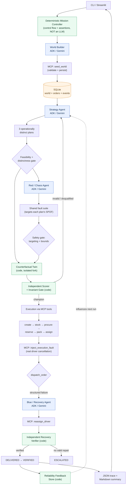

# PARADOX — Predictive Autonomous Recovery & Digital Operations eXchange

> **Don't just recover from failure. Prevent the future that causes it.**

PARADOX is a **simulated** multi-agent logistics system that runs a
**counterfactual tournament**: Google ADK / Gemini agents synthesize a world,
propose competing fulfillment plans, and inject adversarial faults; a
deterministic digital twin stress-tests every plan against the *same* faults
without touching real state; a code-based policy gate picks a champion; a
Blue/Recovery agent reacts to a real injected execution fault via MCP tools; and
independent code assertions prove whether recovery actually worked. An
operational feedback store changes how future plans are ranked.

**Integrity statement.** "Real" here means genuine *agent → MCP → persistent
simulation* transitions. It does **not** mean a real supplier purchase or courier
dispatch. PARADOX never claims real delivery, predictive certainty, or proven
superiority beyond what a run's evidence supports.

## What is novel

1. **Counterfactual tournament, not reactive chaining.** Plans are scored by
   simulating each against a *shared* fault suite in an isolated twin before any
   real action — the LLM never self-reports success; deterministic code does.
2. **Red vs Blue grounded in evidence.** The Red/Chaos agent targets each plan's
   *single-point-of-failure dependency* (lone driver, sole supplier, no backup);
   the tournament rewards plans that remove it.
3. **Verified self-healing.** A real driver fault is injected into execution
   state via MCP; recovery is an actual `reassign_driver` MCP call; an
   independent verifier (code) confirms the repair before the order advances.
4. **Operational memory.** A smoothed reliability estimator updates from outcomes
   and feeds back into plan ranking — operational memory, not model training.

## Architecture

```
CLI / Streamlit
     │
     ▼
Deterministic Mission Controller ────────────────────────────────────────┐
     │  (control flow, assertions — NOT an LLM)                           │
     ├─▶ World Builder  (ADK/Gemini) ─▶ MCP seed_world ─▶ SQLite          │
     ├─▶ Strategy       (ADK/Gemini) ─▶ 3 operationally distinct plans    │
     ├─▶ Red / Chaos    (ADK/Gemini) ─▶ shared fault suite                │
     ├─▶ Counterfactual Twin (code)  ─▶ per (plan×fault) isolated fork    │
     │        └▶ Independent Scorer + Invariant Gate (code)               │
     ├─▶ Execution (MCP tools)       ─▶ create→stock→procure→reserve→pack │
     │                                   →assign→[FAULT injected]→dispatch │
     ├─▶ Blue / Recovery (ADK/Gemini)─▶ reassign_driver via MCP           │
     │        └▶ Independent Recovery Verifier (code)                     │
     ├─▶ Feedback store (code)       ─▶ smoothed reliability ─────────────┘
     ▼
JSON trace + Markdown summary  (artifacts/)
```

LLMs do world synthesis, strategy, chaos, and recovery choice. The database,
simulator, scorer, safety gate, and verifier are **code** — never an LLM.

### End-to-end mission flow



> **Blue (ADK) = LLM agents • Green (code) = deterministic engines • Orange = persistent state.**
> The LLM only *proposes*; every proposal passes a code gate before it can touch
> state or scoring.

## Requirements checklist

- Python 3.10+ (tested on 3.12).
- `google-adk==2.12.0`, `mcp==2.3.0`, `pydantic`, `python-dotenv`, `pytest`.
- A free Gemini API key for the live demo (https://aistudio.google.com/apikey).
  Deterministic tests and `doctor` run **without** a key.

## Quickstart

```bash
python3 -m venv .venv && source .venv/bin/activate
pip install -r requirements.txt
cp .env.example .env            # then set GOOGLE_API_KEY=... (never commit it)

python -m paradox doctor                      # env + MCP readiness (no key needed for most checks)
python -m paradox demo --scenario driver_failure --json-output artifacts/demo.json
python -m paradox validate --report artifacts/demo.json
python -m paradox benchmark --runs 5 --json-output artifacts/benchmark.json
pytest -q                                     # deterministic checks, no key needed
streamlit run app.py                          # optional viewer over the artifacts
```

## Sample output (ILLUSTRATIVE — not a committed run result)

```
$ python -m paradox demo --scenario driver_failure --json-output artifacts/demo.json
demo report -> artifacts/demo.json
final order status: VERIFIED
assertions: 8/8 passed
```

> The numbers above are an illustrative shape. Real values are generated at
> runtime into `artifacts/demo.json` and derived into `artifacts/demo_summary.md`.
> `validate` re-reads the report independently and returns a nonzero exit code if
> any mandatory property fails — it does not trust a `success: true` string.

## Report file layout (`artifacts/`)

| file | contents |
|---|---|
| `demo.json` | full evidence envelope: model calls, MCP calls, plans, shared faults, tournament, isolation proof, execution events, recovery verifications, assertions, feedback before/after, limitations |
| `demo_summary.md` | human summary derived *from* `demo.json` facts |
| `tournament.json` | plans + shared faults + ranked scoring + champion explanation |
| `benchmark.json` / `_summary.md` | cheapest-first vs PARADOX over N paired trials |
| `world_snapshot.json` | the agent-generated world, labeled `agent_generated`, reusable for replay |

## Interpreting the evaluation

- **Tournament score** = `0.40·resilience + 0.30·deadline + 0.20·cost + 0.10·verification`
  on normalized components. Weights are a **demo policy**, not a proven optimum.
- **Isolation** must show `hash_unchanged = true` and `versions_unchanged = true`
  (the twin never mutated the baseline).
- **Recovery** must show a `driver` verification with `verified: true` and the
  final order status `VERIFIED`, reached through legal, evented transitions.

## Simulated vs real — precise disclosure

| Component | Nature |
|---|---|
| Agents (World/Strategy/Chaos/Recovery) | **Real** ADK/Gemini LLM calls |
| MCP server + tools | **Real** MCP protocol over stdio |
| World data | **Agent-generated** (validated + persisted by code) |
| Logistics execution | **Simulated** state machine in SQLite |
| Purchases / deliveries | **Simulated** — no real money, supplier, or courier |
| Scoring / verification / isolation | **Deterministic code**, never an LLM |

See `JUDGE_GUIDE.md` for exactly what to run and inspect, and `ARCHITECTURE.md`
for trust boundaries and design decisions.

## License

MIT — see `LICENSE`.
